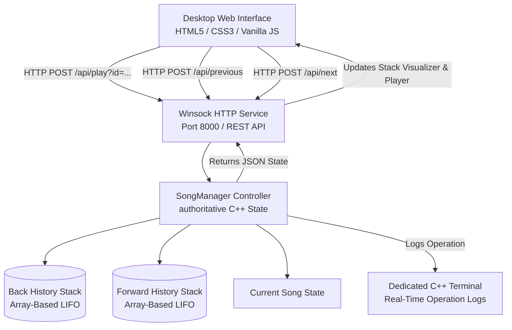
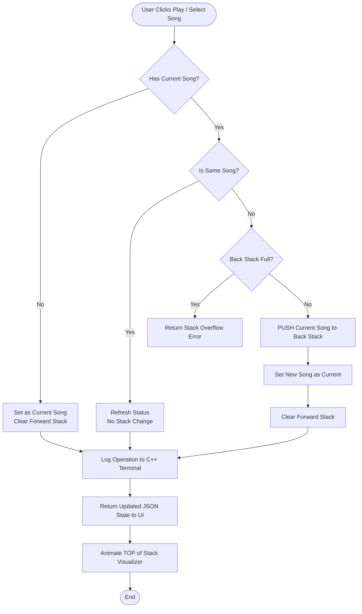

# StackSound: Music Recently-Played Manager Using Stack
## Academic Mini-Project Report & CCE-4 Presentation Guide
**Course:** Fundamental of Data Structures (B.Tech SEM 3)  
**Primary Data Structure:** Stack (LIFO: Last-In, First-Out)  
**Implementation Language:** C++ (Dev-C++ 5.11 / MinGW64 Compatible)  
**Repository:** [https://github.com/pritiudata0810-commits/Music-Recently-Played-Manager.git](https://github.com/pritiudata0810-commits/Music-Recently-Played-Manager.git)  

---

## 1. Introduction
A **Stack** is a linear data structure that adheres to the **LIFO (Last-In, First-Out)** principle. In a stack, elements are added and removed from a single point of access known as the **TOP**.

### Key Characteristics:
- **LIFO (Last-In, First-Out):** The element inserted most recently is the first one to be removed.
- **Single-Ended Access:** All insertions and deletions take place at `topIndex`.
- **Core Operations:**
  - `push(item)`: Inserts a new element at the TOP of the stack.
  - `pop()`: Removes and returns the element currently at the TOP.
  - `peek()` / `top()`: Inspects the TOP element without removing it.
  - `isEmpty()`: Checks whether the stack contains zero elements.
  - `isFull()`: Checks whether the stack has reached its maximum allocated capacity.
  - `size()`: Returns the current count of elements stored.
  - `clear()`: Resets the stack to an empty state.

---

## 2. Problem Statement
Modern digital media applications (such as Apple Music, Spotify, and YouTube) track playback history and allow users to step backward to previously listened tracks. In computer science, this is an authentic real-world application of the **Stack** data structure.

This project implements **StackSound**, a music-player history simulator managing a curated Bollywood music library. It models bidirectional playback navigation using two cooperative stacks:
1. **Back History Stack:** Stores previous songs in LIFO order for backward navigation.
2. **Forward History Stack:** Stores songs that can be revisited after navigating backward.
3. **Current Song Pointer:** Holds the actively selected song.

The project demonstrates:
- A pure, manual C++ array-based Stack implementation without `std::stack`.
- Dev-C++ 5.11 compatibility on Windows.
- A clean, Apple Music-inspired desktop graphical user interface with real-time visual stack animation.
- A local C++ communication layer serving live formatted terminal logs for university viva demonstration.

---

## 3. Project Objectives
1. **Conceptual Mastery:** Understand internal stack pointers (`topIndex`), boundary conditions (Overflow and Underflow), and memory mechanics.
2. **Manual C++ Implementation:** Implement an array-based stack from scratch with explicit bounds checking and error handling.
3. **Dual-Stack Navigation:** Apply dual stacks to manage browser-style navigation history (Back and Forward).
4. **Interactive Verification:** Provide both an independent console program for Dev-C++ and a responsive desktop web interface linked via Windows Sockets (Winsock).
5. **Truthful Terminal Logging:** Print real-time C++ operation logs to a separate terminal window to verify authentic backend execution during academic evaluations.

---

## 4. Proposed Solution & Architecture

### High-Level System Architecture


---

## 5. Algorithms

### Algorithm 1: Play New Song (`playSong(songId)`)
1. **Input:** `songId` string representing the selected song.
2. Find song record in predefined library matching `songId`. If not found, return `ERROR`.
3. If `hasCurrentSong` is `true` AND `currentSong.id == songId`:
   - No-op policy: Song is already active. Return `SUCCESS` without altering stacks.
4. If `hasCurrentSong` is `true`:
   - Check `backHistory.isFull()`. If full, return `STACK OVERFLOW`.
   - `backHistory.push(currentSong)`.
   - Set `currentSong = targetSong`.
   - `forwardHistory.clear()` (starting a new branch invalidates forward history).
5. Else (`hasCurrentSong` is `false`):
   - Set `currentSong = targetSong`.
   - `hasCurrentSong = true`.
   - `forwardHistory.clear()`.
6. Log action to terminal and return updated state.

### Algorithm 2: Previous Song (`previousSong()`)
1. Check `backHistory.isEmpty()`. If true, return `STACK UNDERFLOW` ("No previous songs").
2. If `hasCurrentSong` is `true`:
   - `forwardHistory.push(currentSong)`.
3. `backHistory.pop(previousSong)`.
4. Set `currentSong = previousSong`.
5. Log action to terminal and return updated state.

### Algorithm 3: Next Song (`nextSong()`)
1. Check `forwardHistory.isEmpty()`. If true, return `STACK UNDERFLOW` ("No forward songs").
2. If `hasCurrentSong` is `true`:
   - `backHistory.push(currentSong)`.
3. `forwardHistory.pop(nextSong)`.
4. Set `currentSong = nextSong`.
5. Log action to terminal and return updated state.

### Algorithm 4: Peek Top History (`peekHistory()`)
1. Check `backHistory.isEmpty()`. If true, return `EMPTY STACK`.
2. Retrieve `backHistory.peek(topSong)`.
3. Return `topSong` metadata without decrementing `topIndex`.

### Algorithm 5: Clear History (`clearHistory()`)
1. `backHistory.clear()`.
2. `forwardHistory.clear()`.
3. Preserve `currentSong` selection.
4. Log action and return updated state.

---

## 6. Navigation Logic Flowchart



---

## 7. Implementation Details

### Chosen Approach: Array-Based Stack (`SongStack`)
- **Fixed Capacity:** `MAX_STACK_CAPACITY = 25`
- **Top Pointer:** `int topIndex = -1` (initialized to empty)
- **Data Array:** `Song elements[MAX_STACK_CAPACITY]`
- **Why Array-Based over Linked List for Academic Evaluation?**
  1. It provides strict demonstration of array indexing and pointer management (`topIndex`).
  2. It explicitly tests boundary conditions: `isFull()` (Overflow) and `isEmpty()` (Underflow).
  3. Constant $O(1)$ access without dynamic heap allocation overhead or memory leaks.

### Source Files Structure:
- `src/song.h`: Data definition of Song with JSON serialization.
- `src/stack.h` & `src/stack.cpp`: Core `SongStack` class with manual operations.
- `src/song_manager.h` & `src/song_manager.cpp`: Dual-stack manager, Bollywood library, and terminal logger.
- `src/main_standalone.cpp`: Standalone Dev-C++ interactive console menu.
- `src/devcpp_single_file.cpp`: Single-file helper for one-click F9 execution in Dev-C++.
- `src/backend_server.cpp`: Windows Sockets HTTP server with CORS and static file delivery.
- `frontend/index.html`: Apple Music-inspired desktop layout with Stack visualizer.
- `frontend/style.css`: Clean charcoal and warm amber aesthetics, floating player bar.
- `frontend/app.js`: Authoritative client synchronization logic.
- `assets/`: 12 custom vector SVG album covers.
- `tests/test_stack.cpp`: Automated 60-point C++ test suite.

---

## 8. Complexity Analysis

| Operation | Time Complexity | Space Complexity | Explanation |
| :--- | :---: | :---: | :--- |
| `push()` | $\mathcal{O}(1)$ | $\mathcal{O}(1)$ | Single boundary check, increment `topIndex`, direct array assignment. |
| `pop()` | $\mathcal{O}(1)$ | $\mathcal{O}(1)$ | Single underflow check, direct array retrieval, decrement `topIndex`. |
| `peek()` | $\mathcal{O}(1)$ | $\mathcal{O}(1)$ | Direct array access at `elements[topIndex]`, zero index movement. |
| `isEmpty()` | $\mathcal{O}(1)$ | $\mathcal{O}(1)$ | Single integer comparison (`topIndex == -1`). |
| `isFull()` | $\mathcal{O}(1)$ | $\mathcal{O}(1)$ | Single integer comparison (`topIndex == MAX - 1`). |
| `size()` | $\mathcal{O}(1)$ | $\mathcal{O}(1)$ | Arithmetic return (`topIndex + 1`). |
| `clear()` | $\mathcal{O}(1)$ | $\mathcal{O}(1)$ | Direct assignment (`topIndex = -1`). |
| `display()` | $\mathcal{O}(N)$ | $\mathcal{O}(1)$ | Traverses and prints $N$ elements from $top$ down to $0$. |

**Overall Space Complexity:** $\mathcal{O}(MAX\_CAPACITY) = \mathcal{O}(1)$ fixed contiguous memory.

---

## 9. Actual Terminal Logs Captured During Execution

```text
======================================================================
                 STACKSOUND - C++ STACK BACKEND                       
======================================================================
 Action:               PLAY NEW SONG
 Operation:            INITIAL SELECTION
 Status:               SUCCESS
 Details:              Selected initial song 'Kesariya'. No previous song pushed.
 Affected Item:        Kesariya
 Current Song:         Kesariya (Arijit Singh)
 Back History Size:    0 / 25 (LIFO Stack)
 Forward History Size: 0 / 25
 Back History Top:     [EMPTY STACK]
======================================================================

======================================================================
                 STACKSOUND - C++ STACK BACKEND                       
======================================================================
 Action:               PLAY NEW SONG
 Operation:            PUSH
 Status:               SUCCESS
 Details:              Pushed previous song 'Kesariya' onto Back History Stack. Started new navigation track.
 Affected Item:        Kesariya
 Current Song:         Heeriye (Jasleen Royal, Arijit Singh)
 Back History Size:    1 / 25 (LIFO Stack)
 Forward History Size: 0 / 25
 Back History Top:     Kesariya (Arijit Singh)
======================================================================

======================================================================
                 STACKSOUND - C++ STACK BACKEND                       
======================================================================
 Action:               PREVIOUS SONG
 Operation:            POP (BACK HISTORY) + PUSH (FORWARD)
 Status:               SUCCESS
 Details:              Popped 'Kesariya' from Back History Stack into Current Song. Pushed previous song to Forward History.
 Affected Item:        Kesariya
 Current Song:         Kesariya (Arijit Singh)
 Back History Size:    0 / 25 (LIFO Stack)
 Forward History Size: 1 / 25
 Back History Top:     [EMPTY STACK]
======================================================================
```

---

## 10. Sample Viva Voce Questions & Answers

**Q1: Why is Stack considered a LIFO data structure?**  
*Answer:* LIFO stands for Last-In, First-Out. In a stack, insertions and deletions are restricted to a single end called the TOP. Therefore, the item inserted most recently is the first one removed when a pop occurs.

**Q2: What happens if you pop from an empty stack?**  
*Answer:* This condition is called **Stack Underflow**. Our implementation handles this by checking `isEmpty()` first and returning `false` with a user-friendly error message, preventing illegal memory access.

**Q3: What happens if you push onto a full array-based stack?**  
*Answer:* This condition is called **Stack Overflow**. Because our array has a fixed capacity (`MAX_STACK_CAPACITY = 25`), pushing beyond this limit is caught by `isFull()`, returning `false` and notifying the user.

**Q4: Why does selecting a new song clear the Forward History Stack?**  
*Answer:* This mirrors standard browser and media player navigation. When a user navigates backward and then selects an entirely new song from the library, they begin a new branch of navigation history. The previous forward branch is invalidated and cleared.

**Q5: What is the time complexity of Stack operations?**  
*Answer:* In our array-based implementation, `push`, `pop`, `peek`, `isEmpty`, `isFull`, and `size` all execute in constant time $\mathcal{O}(1)$ because they simply manipulate `topIndex` and access a direct array offset.

---

## 11. Academic References
1. Lipschutz, Seymour. *Data Structures (Schaum's Outlines)*. McGraw-Hill Education.
2. Tanenbaum, Aaron M., Langsam, Yedidyah, and Augenstein, Moshe J. *Data Structures Using C and C++*. Prentice Hall.
3. Stroustrup, Bjarne. *The C++ Programming Language (4th Edition)*. Addison-Wesley.
4. Microsoft Corporation. *Windows Sockets 2 (Winsock)* Documentation.
